# ConvNeXt (from scratch) for AD vs CN classification on ADNI brain MRI

COMP3710 Pattern Recognition · Hard difficulty · Student s4985919 · Folder `recognition/ConvNeXt_Bai_s4985919/`

> Research prototype, not a clinical tool. **The 0.80 test-accuracy target was not reached by ConvNeXt**: 75.31 % slice-level test accuracy on the provided split (which shares subjects between train and test), 65.78 % with strict subject separation, and 76.19 % on the corrected subject-disjoint split released by the teaching team. On that corrected split, a plain CNN with the same number of parameters reached 85.16 % (Section 10).

## 1. Problem and algorithm

**Problem.** Alzheimer's disease (AD) causes progressive cortical and hippocampal atrophy and ventricular enlargement that is visible on T1-weighted structural MRI. The task is to classify 2D MRI slices from the course ADNI data as AD or cognitively normal (CN; the course folder calls this class `NC`). The teaching team confirmed that the target metric is **slice-level accuracy on the official test folder** and that pretrained weights are not allowed. The open engineering question for this project is whether the model's confidence can be trusted to send ambiguous cases to a human reader, and whether a modern architecture justifies its cost over a simple baseline.

**How it works.** ConvNeXt [1] modernises a ResNet-style convolutional network with ideas from vision transformers. A 4 × 4, stride-4 "patchify" stem turns the 224 × 224 input into a 56 × 56 feature map. Four stages follow, separated by 2 × 2 stride-2 down-sampling layers. Each ConvNeXt block applies a 7 × 7 depthwise convolution (large spatial context, few parameters), LayerNorm, an inverted bottleneck (1 × 1 expansion to 4× width, GELU, projection back), a learnable per-channel LayerScale and stochastic depth on the residual branch. Global average pooling, LayerNorm and a linear layer give two logits (AD, CN). This implementation (`modules.py`) is a compact version written from scratch for this dataset size: depths (2, 2, 4, 2), widths (32, 64, 128, 256), LayerScale initialised to 1e-6, stochastic depth up to 0.1, **1,900,898 parameters** and no pretrained weights. The baselines (`baseline.py`) are a small 3-layer CNN with 23,714 parameters (Section 5) and a parameter-matched plain CNN with 1,834,122 parameters (Section 10).

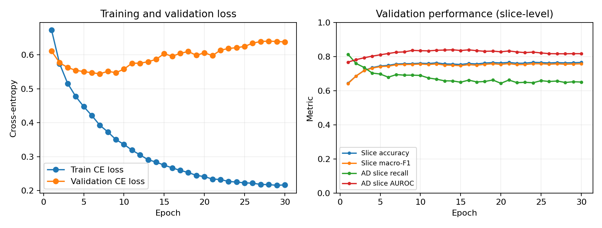

*Training and validation curves of run `official_cosine_ema_context3_s42` (one member of the final ensemble). The training loss includes label smoothing 0.1, while the validation loss is plain cross-entropy, so the two loss curves are not directly comparable even though both are labelled "CE loss" in the plot.*

**Example input and output.** The input is one 2D MRI slice (`scanID_sliceNo.jpeg` from `AD_NC/train` or `AD_NC/test`), resized to 224 × 224; with `context3`, the previous and next slice of the same scan are stacked as the other two channels. The output is a probability that the slice shows AD, thresholded at 0.5 (example console output in Section 13). The figure below shows one AD and one CN example from the validation subjects (chosen with a fixed random seed, not selected for being correct), the three input channels as the model sees them, and the ensemble's output; it is produced by `show_examples.py`.

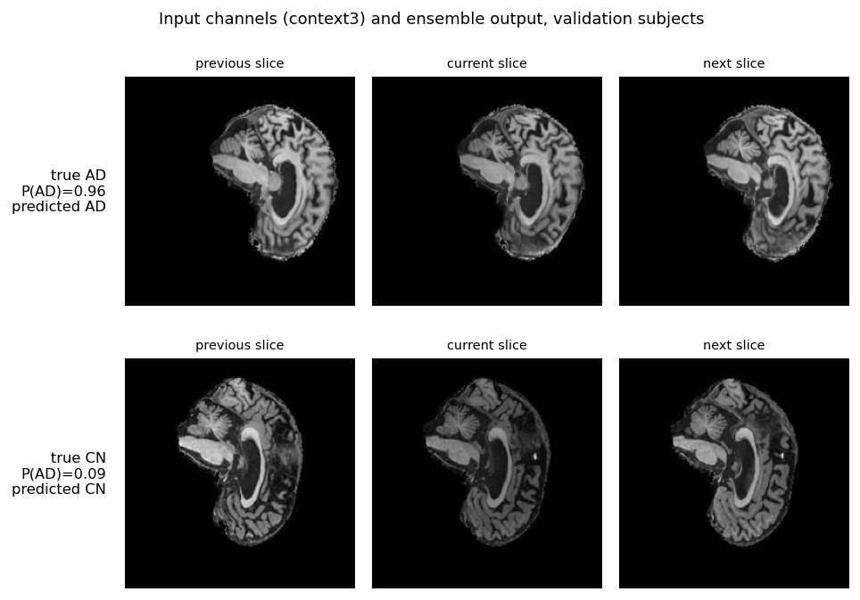

*Data used in this project were obtained from the Alzheimer's Disease Neuroimaging Initiative (ADNI) database (adni.loni.usc.edu), through the course copy on Rangpur. Only these two example slices are shown; no other images and no scan or subject IDs are published.*


## 2. Headline results

| Setting | Model | Test slice accuracy | AUROC (AD) | What it measures |
|---|---|---|---|---|
| **Official split** (course folders as given) | ConvNeXt, 3-seed ensemble, 3-slice context input | **75.31 %** | 0.847 | Not subject-independent: 216 of the 331 test subjects have another visit in the training folder |
| **Strict split** (those 216 subjects removed from training) | ConvNeXt, single model, 8 epochs, earlier recipe, AD threshold 0.67 chosen on validation | **65.78 %** | 0.73 | Generalisation to new subjects |
| Official split, same test slices | SimpleCNN baseline | 66.46 % | 0.732 | Baseline under identical evaluation |
| **Corrected split** (teaching-team release, 0 shared subjects; Section 10) | ConvNeXt, 3-seed ensemble, same recipe | **76.19 %** | 0.840 | Generalisation to new subjects with matched train/test distributions |
| Corrected split, same test slices | MatchedCNN (parameter-matched plain CNN), 3-seed ensemble | 85.16 % | 0.929 | Is ConvNeXt's design worth it at equal model size? |

Why two splits: the course folders are separated by *scan* (ADNI Image ID), not by *subject*. Mapping image IDs to subject IDs with the course metadata shows 216 subjects with different visits in both folders. I reported this to the teaching team on Ed. The tutor (Zhao Wang, 18 Oct 2026, thread now private) advised using **the provided split as the primary result** and reporting the patient-disjoint results as a clearly labelled comparison, which is what this report does. The official split is therefore the primary result, but it is not subject-independent; the strict split is the better estimate for completely new patients. After the teaching team released a corrected subject-disjoint copy of the data (22 Oct 2026), I re-ran the final recipe on it under a protocol fixed in advance; Section 10 reports these results and what they reveal about patient leakage.

Breaking the official-split ensemble down by whether the test subject was seen in training shows where the score comes from:

| Test subjects | Slices | Share AD | Accuracy | AD recall | CN recall |
|---|---|---|---|---|---|
| Seen in training folder (216) | 5,560 | 37 % | **90.4 %** | 88.1 % | 91.9 % |
| Not seen (115) | 3,440 | 69 % | **50.8 %** | **33.3 %** | 90.2 % |

On new subjects the model still recognises CN scans, but it misses two thirds of AD slices. Because the unseen group is mostly AD, its overall accuracy falls to 50.8 %.

**Secondary, aggregated levels** (reported by `predict.py` for every evaluation since the start of the project, not the target metric): averaging the AD probability over the 20 slices of a scan, or over all scans of a subject, gives test accuracy 77.33 % per scan and 82.18 % per subject for the official-split ensemble (validation: 80.19 % and 84.07 %), and 66.44 % / 70.09 % for the strict-split model. The tutor confirmed that the assessed metric is slice-level, so these numbers are context only and do not mean the 0.80 target was met.

**Test-set use.** The official test folder was already evaluated during development, before this write-up (Section 9). For the final models, checkpoints (best epoch), the AD threshold (0.5, fixed before training) and the reject rule were chosen on validation only, and nothing was changed after looking at the test breakdowns in Sections 5–7. The 3-slice input was preferred because it scored higher on validation than single-slice input (76.55 % vs 75.56 % at seed 42; Section 9). The ensemble is used because its validation accuracy (76.88 %) is higher than that of each of its three members (76.55–76.79 %). I cannot rule out that test accuracies of single seeds were also viewed during development; the saved logs in `run_logs/evaluation/` contain test results only for the runs listed in Section 9 and for the ensemble.

## 3. Data, pre-processing and splits

- Data: `/home/groups/comp3710/ADNI/AD_NC` (`train/` and `test/`, classes `AD` and `NC`) and the metadata file `/home/groups/comp3710/ADNI/meta_data_with_label.json`. Each scan contributes 20 JPEG slices named `scanID_sliceNo.jpeg`; the prefix is the ADNI Image ID of one scan, not a patient. The subject ID (e.g. `137_S_4672`) is taken from the metadata `raw` path with the regex `\d{3}_S_\d{4}`.
- Labels: AD = class 0 (positive class for recall and AUROC), CN = class 1, following ImageFolder order. The mapping is asserted in every script.
- Pre-processing (`dataset.py`): resize to 224 × 224, convert to greyscale, replicate to 3 channels, scale to [0, 1] and normalise with mean = std = 0.5, so pixels lie in [−1, 1].
- Input modes: `single` copies one slice into the 3 channels. `context3` (2.5D) puts the previous, current and next slice **of the same scan** into the 3 channels, with edge slices repeated. Every sample is still one slice with its own label, so evaluation stays per slice.
- Training-only augmentation: random affine (±6°, ±3 % shift, 0.97–1.03 scale, background filled black) and Gaussian noise (σ = 0.01). No left-right flips, because hemispheric asymmetry may carry information. Optional `--intensity-augment` adds a random scale and gamma (0.9–1.1). Validation and test images are never augmented.
- Validation is split **by subject** (20 %, stratified, seed 42) in both modes; code assertions guarantee that no subject is in both training and validation.

| Mode | Training | Validation | Test |
|---|---|---|---|
| `strict` | 279 subjects, 10,080 slices | 70 subjects, 2,620 slices | 331 subjects, 450 scans, 9,000 slices |
| `official` | 452 subjects, 17,380 slices | 113 subjects, 4,140 slices | same |

In strict mode, 8,820 training slices (41 %) are removed because their subject appears in the test folder. Official mode prints a leakage warning (186 training and 30 validation subjects overlap with test). The test folder has 4,460 AD and 4,540 CN slices. `python dataset.py strict` or `python dataset.py official` prints these counts.

## 4. Training

`train.py` imports the model from `modules.py` and the data from `dataset.py`. Final recipe (`run_recipe.slurm`): AdamW (lr 3e-4, weight decay 0.03), batch size 8, 30 epochs, 1 warm-up epoch followed by per-step cosine decay, exponential moving average of the weights (decay 0.999; the EMA weights are validated and saved), label smoothing 0.1 and the augmentation above. After every epoch the model is scored on validation, and `best.pth` is kept when the **validation slice macro-F1 at AD threshold 0.5** improves (ties: AD recall, then validation loss). Every run saves `best.pth`, `best_meta.json` (selection settings, split fingerprints), `last.pth` (resumable state, also on Slurm time-out), `history.json`, `config.json` and `training_curves.png`. The final ConvNeXt is an ensemble of three seeds (42, 43, 44) that averages the AD probability.

## 5. Baseline comparison (official split, identical test slices)

Baseline: `SimpleCNN` (3 conv layers 16/32/64 + ReLU + max-pool, global average pool, linear), single-slice input, same split and same recipe, one seed. Its best epoch was chosen on validation (epoch 4, validation macro-F1 0.680).

| Test metric (slice level, threshold 0.5) | ConvNeXt ensemble | SimpleCNN |
|---|---|---|
| Accuracy | **75.31 %** | 66.46 % |
| AUROC (AD positive) | **0.847** | 0.732 |
| AD precision / recall / F1 | 0.872 / 0.589 / 0.703 | 0.731 / 0.511 / 0.602 |
| CN precision / recall / F1 | 0.694 / 0.915 / 0.789 | 0.629 / 0.815 / 0.710 |
| Macro-F1 | **0.746** | 0.656 |
| Confusion (TP, FN, FP, TN; AD positive) | 2625, 1835, 387, 4153 | 2279, 2181, 838, 3702 |
| Validation accuracy / AUROC / macro-F1 | 76.88 % / 0.858 / 0.762 | 68.91 % / 0.761 / 0.680 |
| Test accuracy, seen / unseen subjects | 90.4 % / 50.8 % | 75.6 % / 51.6 % |

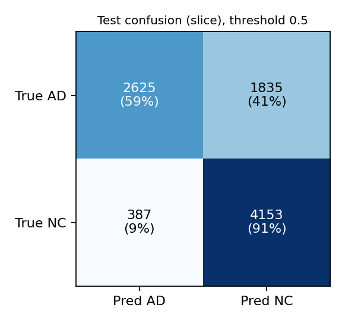
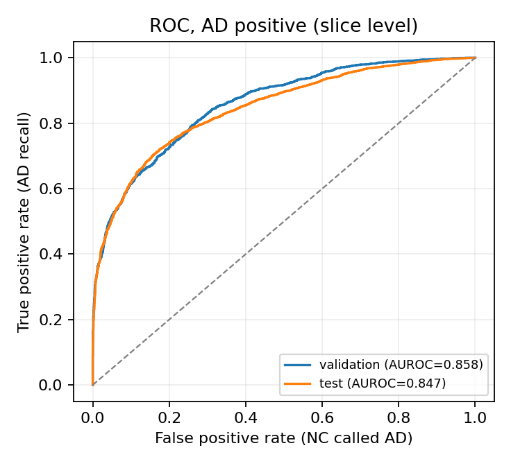

Caveats:
- The ConvNeXt column bundles architecture, 3-slice input and a 3-model ensemble, so the 8.9-point gap is a *pipeline* difference, not an architecture-only effect. A single-seed, single-slice ConvNeXt was not evaluated on test, to avoid extra test looks. The fairer comparison (same input, same ensemble size and a similar parameter count) was done later on the corrected split and reverses the conclusion (Section 10).
- The recipe was tuned for ConvNeXt. Under it the CNN was unstable: from epoch 5 it drifted towards predicting CN almost everywhere (AD recall 2.8 % at epoch 30, validation AUROC still about 0.77). Validation-based checkpoint selection kept the epoch-4 weights. A CNN-specific recipe was not tuned.
- Both models are about equally poor on unseen subjects (50.8 % vs 51.6 %), so the architecture does not fix the subject-generalisation problem.

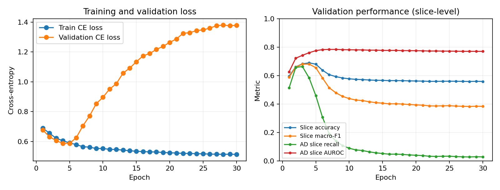

## 6. Open dilemma: confidence, calibration and a reject option

**Does confidence track correctness?** Partly. ConvNeXt's mean confidence is 0.888 on correct and 0.811 on wrong test slices, and accepted-slice accuracy rises as fewer slices are accepted (coverage curve). But it is over-confident everywhere (reliability curve below the diagonal, test ECE 0.118), and **959 of its 2,222 test errors have confidence ≥ 0.9**. The training curves show the same drift: for seed 42 the validation loss rises from 0.544 (epoch 7) to 0.638 (epoch 30) while validation accuracy stays near 76 %, i.e. the model becomes more confident without becoming more accurate. Because of label smoothing 0.1, the ensemble's confidence rarely exceeds about 0.95, which also limits how high the top reliability bins can go. The CNN has a lower average calibration error (ECE 0.028; Brier 0.218 vs 0.186) mainly because it is rarely confident (mean confidence 0.691 correct vs 0.651 wrong), so its confidence barely separates right from wrong. Worse, its *few* very confident test predictions are mostly wrong: of the 102 test slices with confidence above 0.933 only 35 are correct (34 %), and of the 24 above 0.967 only 1 is correct, so its accepted-slice accuracy on test collapses at low coverage. A low average ECE therefore hides the most dangerous errors.

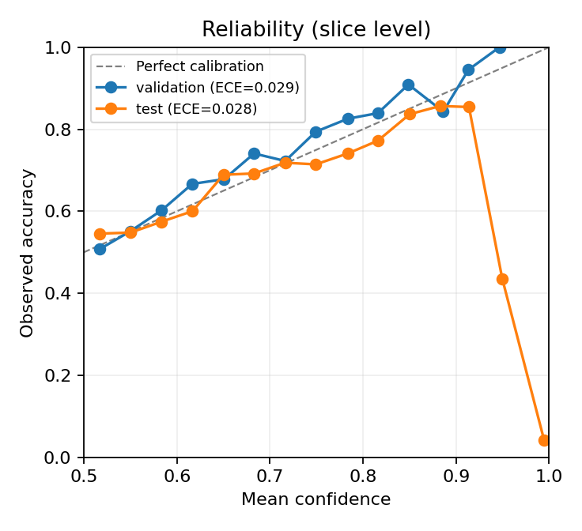

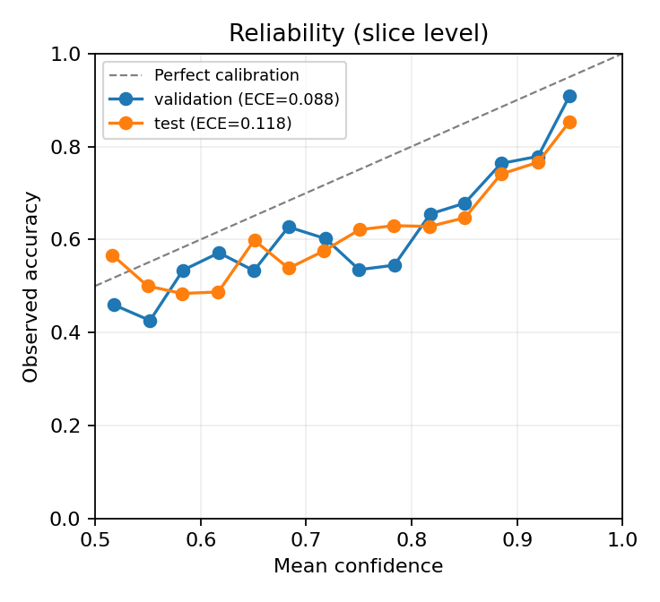
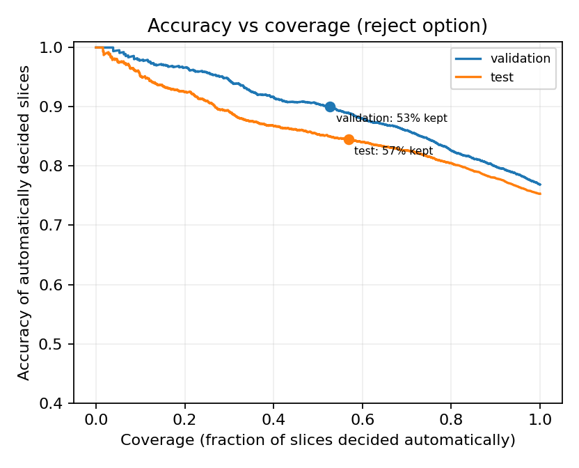

**Reject rule.** A slice is referred to a human reader when confidence (probability of the predicted class) is below a cut-off. The cut-off was fixed in advance as the lowest one giving 90 % accepted accuracy **on validation**, then applied unchanged to test.

| | Cut-off | Coverage (decided automatically) | Accuracy of accepted slices | Accuracy of referred slices | AD slices missed and not referred |
|---|---|---|---|---|---|
| ConvNeXt, validation | 0.923 | 52.7 % | 90.0 % | 62.2 % | 196 of 1,860 |
| ConvNeXt, test | 0.923 | 56.8 % | **84.6 %** | 63.1 % | **757 of 4,460 (17 %)** |
| CNN, validation | 0.822 | 10.7 % | 90.1 % | 66.4 % | 19 of 1,860 |
| CNN, test | 0.822 | 12.2 % | 79.1 % | 64.7 % | 222 of 4,460 |

The rule transfers poorly: 90 % on validation became 84.6 % on test, and test coverage went *up*, i.e. the model is more confident on the shifted test data while being less accurate.

## 7. Where and why it fails (official test, ConvNeXt ensemble)

These breakdowns were made after the final test run. They describe the results; nothing was tuned on them.

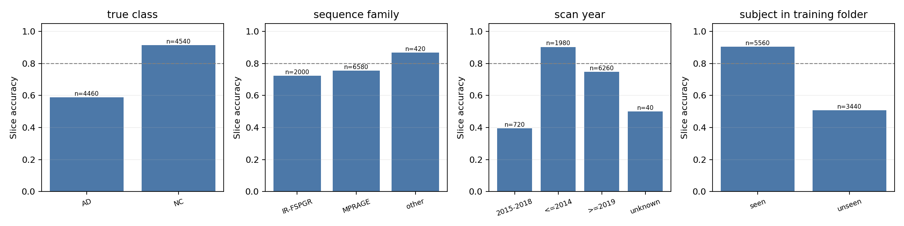

| Group | Slices | Share AD | Accuracy | AD recall | CN recall |
|---|---|---|---|---|---|
| Sequence IR-FSPGR | 2,000 | 50 % | 72.4 % | 52.9 % | 91.9 % |
| Sequence MPRAGE | 6,580 | 47 % | 75.5 % | 57.2 % | 91.3 % |
| Sequence other* | 420 | 95 % | 86.9 % | 86.3 % | 100 % |
| Scan year ≤ 2014 | 1,980 | **100 %** | 90.4 % | 90.4 % | – |
| Scan year 2015–2018 | 720 | **100 %** | 39.6 % | 39.6 % | – |
| Scan year ≥ 2019 | 6,260 | 28 % | 74.8 % | 31.7 % | 91.4 % |

\* "other" = 340 slices of IR-SPGR variants (the script groups names by the substrings "FSPGR" and "MPRAGE") plus 80 slices with no sequence name. Scan year is the date in the ADNI raw filename; 40 slices have no year.

Findings (correlational, not proven causes):
1. **Scan year and label are confounded in the test folder.** Every test scan from before 2019 is AD, and every CN scan is from 2019 or later. AD recall falls from 90 % (≤ 2014) to 40 % (2015–2018) and 32 % (≥ 2019). Year, subject overlap (seen subjects: AD recall 88 %; unseen: 33 %) and disease stage were not cross-tabulated here and may overlap, so "acquisition era" is a plausible shortcut but not demonstrated.
2. **Sequence family does not explain the failure for ConvNeXt**: IR-FSPGR and MPRAGE give similar AD and CN recall.
3. **The CNN does show a sequence shortcut.** On IR-FSPGR its AD recall is 81.7 % but CN recall 52.1 %; on MPRAGE it is the reverse (37.5 % and 89.8 %), with similar class balance in both. ConvNeXt is stable across sequences.
4. Both models are biased towards CN: most errors are missed AD (1,835 FN vs 387 FP for ConvNeXt).

### Failure autopsies

For each error type the most *confidently wrong* **scans** were selected (scan probability = mean of its 20 slices). These are deliberately worst cases, not average errors. Raw scan IDs stay local (`failure_cases_LOCAL_ONLY.csv`, git-ignored), and MRI images are not published.

| # | Model | Truth → predicted | Scan P(AD) | Sequence, year | Subject seen in training? |
|---|---|---|---|---|---|
| 1 | ConvNeXt | AD → CN | 0.050 | Accelerated Sagittal MPRAGE, 2018 | no |
| 2 | ConvNeXt | AD → CN | 0.050 | Accelerated Sagittal MPRAGE, 2019 | no |
| 3 | ConvNeXt | CN → AD | 0.879 | Accelerated Sagittal IR-FSPGR, 2021 | yes |
| 4 | ConvNeXt | CN → AD | 0.809 | Accelerated Sagittal MPRAGE, 2019 | yes |
| 5 | SimpleCNN | AD → CN | 0.0004 | Accelerated Sagittal MPRAGE, 2018 | no |

- **Cases 1–2 (missed AD at 95 % confidence).** New subjects, recent MPRAGE scans: exactly the group with 32 % AD recall. *Trigger hypothesis:* the network partly learned subject- or era-specific appearance instead of disease features, and recent AD scans of new subjects look like the recent CN scans it saw. *Check:* train with strict separation and compare AD recall by year on validation. *Mitigation:* strict subject-level training data, a validation set that matches the deployment era, never auto-clearing CN.
- **Cases 3–4 (false alarm on CN).** Both subjects have another visit in the training folder. *Trigger hypothesis:* the subject was AD-labelled at another visit, or looks like one (diagnoses can change between ADNI visits). *Check:* compare with the labels of the subject's other visits in the metadata. *Mitigation:* audit per-visit labels before training.
- **Case 5 (CNN, 99.96 % confident and wrong).** Shows that a small model's confidence can also be unreliable, even though its average calibration looks good.

No clinical reading of the images is attempted; there was no radiologist input.

## 8. Resource profile

Measured on an NVIDIA A100 (Rangpur `comp3710` partition) with `torch.cuda.max_memory_allocated` and CUDA-synchronised timing.

| | ConvNeXt | SimpleCNN |
|---|---|---|
| Parameters (one model) | 1,900,898 | 23,714 |
| GPU forward time per slice, batch 16 | 0.587 ms for the **3-model ensemble** | 0.080 ms |
| Peak GPU memory, inference | 100 MB with **3 models** loaded | 117 MB |
| Peak GPU memory, training one model (batch 8, incl. EMA copy and validation) | 225 MB | 106 MB |
| Wall-clock training time, 30 epochs incl. validation every epoch (Slurm elapsed time) | 53–56 min per seed (4 runs: 52:37, 55:29, 53:26, 53:26); about 2.7 h for the 3-seed ensemble | 21 min |

Inference timing covers the GPU forward pass only (no JPEG decoding or loading) over the 9,000 test slices, measured by `analyze.py`; an earlier measurement of the same ensemble by `predict.py` gave 0.854 ms per slice, so timings vary by roughly ±0.3 ms between runs on the shared node. Training times come from Slurm accounting (`sacct`, elapsed time per job). A single ConvNeXt was not timed separately; it should cost roughly a third of the ensemble figure. Peak memory follows activation size more than parameter count: the CNN's first convolution runs at full 224 × 224 resolution, while the ConvNeXt stem down-samples by 4 immediately. Both models fit easily on a 16 GB P100.

## 9. Experiment history

All runs, read from each run's `config.json`, `history.json` and `best_meta.json`. These files are written automatically by `train.py` and are committed unchanged in [`run_logs/`](run_logs/) (with `run_logs/summary.csv`), so every number in the table below can be checked against the original logs; `collect_runs.py` gathers them and draws the figure.

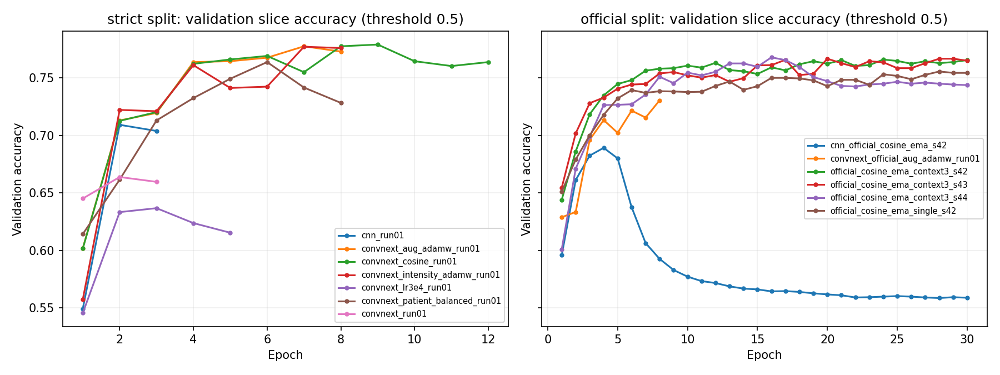

 "Best val acc" is the highest validation slice accuracy at AD threshold 0.5 over all epochs (slightly optimistic, because it is a maximum); "saved" is the validation accuracy of the checkpoint actually kept by the selection rule (validation macro-F1), where the run recorded it. Strict and official runs use **different validation subjects** (70 vs 113), so accuracies are only comparable within the same split.

| # | Run | Split | Change tested | Epochs | Best val acc (epoch) | Saved checkpoint | Verdict |
|---|---|---|---|---|---|---|---|
| 1 | `convnext_run01` | strict | first ConvNeXt: Adam, lr 1e-3, no augmentation | 3 | 66.37 % (2) | – | starting point |
| 2 | `convnext_lr3e4_run01` | strict | lower learning rate 3e-4 | 5 | 63.66 % (3) | – | no gain |
| 3 | `convnext_aug_adamw_run01` | strict | AdamW (wd 0.03) + geometric/noise augmentation | 8 | 77.75 % (7) | – | large gain; kept; tested once (below) |
| 4 | `convnext_cosine_run01` | strict | + cosine learning-rate schedule (earlier implementation) | 12 | 77.90 % (9) | – | +0.15 points, within noise |
| 5 | `convnext_patient_balanced_run01` | strict | + patient-balanced sampling | 8 | 76.37 % (6) | – | no gain |
| 6 | `convnext_intensity_adamw_run01` | strict | + intensity (scale/gamma) augmentation | 8 | 77.71 % (7) | 77.71 % (epoch 7) | no gain |
| 7 | `cnn_run01` | strict | SimpleCNN baseline, Adam, lr 1e-3 | 3 | 70.92 % (2) | – | baseline |
| 8 | `convnext_official_aug_adamw_run01` | official | run 3's recipe on the official split | 8 | 73.04 % (8) | 72.15 % (epoch 6) | evaluated on test during development (71.82 % slice accuracy); superseded |
| 9 | `official_cosine_ema_single_s42` | official | final recipe (30 epochs, warm-up + cosine, EMA, label smoothing), single-slice input | 30 | 75.56 % (28) | 75.56 % (epoch 28) | – |
| 10 | `official_cosine_ema_context3_s42` | official | final recipe, 3-slice context input | 30 | 76.59 % (24) | 76.55 % (epoch 21) | context3 better than single on validation; used |
| 11 | `official_cosine_ema_context3_s43` | official | same, seed 43 | 30 | 76.67 % (20) | 76.67 % (epoch 20) | used |
| 12 | `official_cosine_ema_context3_s44` | official | same, seed 44 | 30 | 76.79 % (16) | 76.79 % (epoch 16) | used |
| 13 | `cnn_official_cosine_ema_s42` | official | SimpleCNN with the final recipe | 30 | 68.91 % (4) | 68.91 % (epoch 4) | baseline (Section 5) |

The 3-seed ensemble of runs 10–12 reaches 76.88 % validation accuracy, slightly above each member (76.55–76.79 %).

**Test result of run 3** (the strict-split model; AD threshold 0.67 chosen on validation, where slice/scan/patient accuracy was 0.788 / 0.855 / 0.886): test slice / scan / patient accuracy **0.658 / 0.664 / 0.701**, patient-level AUROC 0.770 and AD recall 0.473 (69 of 131 AD patients called CN). The large validation–test drop (0.79 → 0.66 at slice level) is a further sign of the shift between the training folder and the test folder.

Other development analyses (training and validation data only; aggregate outputs in [run_logs/diagnostics/](run_logs/diagnostics/)): `diagnose_development.py` audits subject overlap, mixed labels across visits and split fingerprints, and scores the fixed run-3 model (threshold 0.67) on its own training and validation subjects: **87.1 %** slice accuracy on training subjects (AUROC 0.941) and **78.8 %** on new validation subjects (AUROC 0.863). Together with run 3's earlier test result (**65.8 %**, AUROC 0.732, not recomputed), accuracy falls step by step as the data move further from what the model saw. The first gap is ordinary over-fitting to training subjects; the second is the train-folder-to-test-folder shift discussed in Section 7. No validation subject had mixed AD/CN labels across visits.

`test_brightness_sensitivity.py` measures how predictions change when validation images are made 10 % darker or brighter (run 3, AD threshold 0.67, a fixed sample of 280 validation slices from all 70 validation subjects and 122 scans; 95 % intervals from a 200-sample bootstrap over subjects):

| Brightness factor | Accuracy | AD recall | CN recall | AUROC | Slices whose prediction flips |
|---|---|---|---|---|---|
| 1.0 (original) | 77.5 % | 76.4 % | 77.9 % | 0.851 | – |
| 0.9 (10 % darker) | 77.9 % (change +0.4, CI −3.9 to +4.7) | 72.2 % | 79.8 % | 0.848 | 8.9 % (CI 5.7–12.9 %) |
| 1.1 (10 % brighter) | 73.6 % (change **−3.9**, CI −7.1 to −0.7) | 75.0 % | 73.1 % (change −4.8, CI −8.6 to −1.3) | 0.840 | 6.1 % (CI 3.2–9.3 %) |

A global brightness change of only 10 % flips 6–9 % of slice decisions, and brightening lowers accuracy significantly, mostly by calling more CN slices AD. The model is therefore sensitive to intensity differences of the size that can occur between scanners and protocols, which supports the acquisition-shift explanation in Section 7 and the recommendation of per-scan intensity normalisation. Training with random intensity (scale/gamma) augmentation (run 6) did not raise validation accuracy (77.71 % vs 77.75 %); its effect on this sensitivity was not measured.

## 10. Patient leakage: re-evaluation on the corrected subject-disjoint split

The course train and test folders are separated by scan, not by subject (Section 2). After I reported this on Ed, the teaching team released a corrected copy of the data on 22 Oct 2026 in which the same slices are re-assigned by subject: 478 training and 202 test subjects with **no overlap** (I checked this against the metadata; class and slice counts are unchanged: 10,400 / 11,120 training and 4,460 / 4,540 test slices). The tutor had advised on 18 Oct to use the provided split as the primary result (Section 2). After the corrected copy was released, the teaching team (Wei Dai, Ed, 23 Oct 2026) confirmed that using the original data is fine and suggested trying the new split and discussing the patient-leakage finding as a section of the report, which this section does.

**Protocol.** Before any test evaluation on the new split, I committed the evaluation protocol ([`run_logs/adni_v2/PROTOCOL.md`](run_logs/adni_v2/PROTOCOL.md)): the final recipe of Section 4 unchanged, three seeds (42/43/44) per model, checkpoints chosen by validation macro-F1 at threshold 0.5, and one test evaluation per ensemble after all training had finished. Two models were trained this way:

- **ConvNeXt**, context3 input, 3-seed ensemble (as in Section 2).
- **MatchedCNN** (`baseline.py`), a plain VGG-style CNN with **1,834,122 parameters** (ConvNeXt: 1,900,898): four stages of two 3 × 3 conv–BatchNorm–ReLU layers (widths 40/80/160/320), max-pooling, global average pooling and a linear layer. It replaces the 23,714-parameter SimpleCNN so that the comparison is not dominated by model size, as the tutor suggested. Same input, recipe, seeds and selection rule.

Seeds 42 and 43 of ConvNeXt were trained on Rangpur (A100); ConvNeXt seed 44 and all MatchedCNN seeds on the EAIT GPU Lab (NVIDIA L4, same software versions) to avoid a long queue. All six models were evaluated together on Rangpur. Because the split fingerprints include absolute file paths, `predict.py` maps the GPU Lab data root to the Rangpur one before comparing them, so the check still requires identical files, order and labels.

### 10.1 Results (test: 202 unseen subjects, 9,000 slices)

| Test metric (slice level, threshold 0.5) | ConvNeXt ensemble | MatchedCNN ensemble |
|---|---|---|
| **Accuracy** | **76.19 %** | **85.16 %** |
| AUROC (AD positive) | 0.840 | 0.929 |
| AD recall / CN recall | 74.8 % / 77.6 % | 82.4 % / 87.9 % |
| Macro-F1 | 0.762 | 0.851 |
| Confusion (TP, FN, FP, TN; AD positive) | 3336, 1124, 1019, 3521 | 3673, 787, 549, 3991 |
| Validation accuracy / AUROC | 79.12 % / 0.869 | 83.76 % / 0.911 |
| Scan / subject accuracy (secondary) | 79.1 % / 76.2 % | 89.1 % / 87.6 % |
| ECE / Brier (test) | 0.076 / 0.171 | 0.047 / 0.109 |
| Wrong slices with confidence ≥ 0.9 | 561 | 65 |
| Reject rule (90 % accepted accuracy fixed on validation): test coverage / accepted accuracy | 57.5 % / 86.6 % | 75.1 % / 92.3 % |
| AD slices missed and not referred | 370 of 4,460 (8.3 %) | 320 of 4,460 (7.2 %) |
| GPU forward time per slice, 3-model ensemble (A100) | 0.71 ms | 1.14 ms |
| Peak GPU memory: inference (3 models) / training (one model) | 100 MB / 225 MB | 406 MB / 624 MB (training measured on the L4) |
| Wall-clock training per seed (30 epochs) | 52:42 and 52:02 on A100 (seeds 42, 43; Slurm) | about 45 min on L4 (not logged precisely) |

All numbers are in [`run_logs/adni_v2/`](run_logs/adni_v2/). ConvNeXt **does not reach the 0.80 target** on the corrected split either.

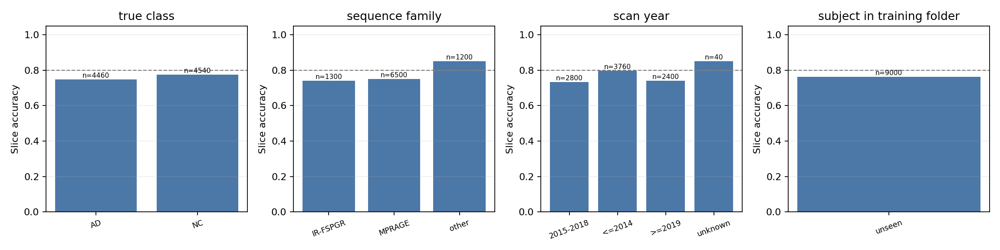
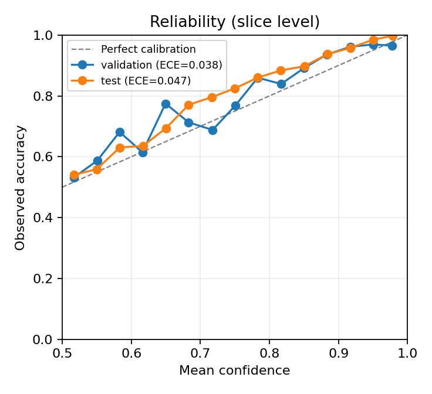

Validation and test differ by about 3 points in opposite directions for the two models (ConvNeXt 79.1 % → 76.2 %, MatchedCNN 83.8 % → 85.2 %). With only 96 validation and 202 test subjects, shifts of this size are plausible from which patients land in each split (no confidence interval was computed); the 9-point gap between the two models on the same 9,000 test slices is three times larger and has the same sign on validation (+4.6 points).

### 10.2 Findings

1. **The old official-split score hid a large subject effect.** On the provided split, ConvNeXt scored 90.4 % on test subjects that also appeared in the training folder but only 50.8 % on the 115 new subjects (Section 2). With every test subject new, the same recipe now reaches 76.2 %, close to the old overall 75.3 % but far above the old 50.8 % for new subjects, and with balanced errors (AD recall 74.8 % vs 58.9 % before). So the old score was not simply inflated by leakage; the old test folder also differed systematically from the training folder (its 115 new subjects were 69 % AD, and scan year was confounded with the label, Section 7). Leakage and folder shift both distorted the old result.

| ConvNeXt, same evaluation code | Test subjects also in training | Test accuracy | AUROC | AD recall | CN recall |
|---|---|---|---|---|---|
| Provided split, final recipe (Section 2) | 216 of 331 | 75.31 % | 0.847 | 58.9 % | 91.5 % |
| Provided split with those subjects removed from training, earlier recipe (run 3, threshold 0.67) | 0 | 65.78 % | 0.732 | 49.9 % | 81.4 % |
| **Corrected split, final recipe** | **0** | **76.19 %** | **0.840** | **74.8 %** | **77.6 %** |

2. **At matched size, the plain CNN is better on this data.** MatchedCNN beats ConvNeXt on every accuracy and reliability measure: +9.0 points accuracy, +0.088 AUROC, lower calibration error, far fewer confident errors, and a reject rule that transfers from validation to test (90.0 % → 92.3 % at 75 % coverage, versus 90.0 % → 86.6 % at 57.5 % for ConvNeXt). ConvNeXt is only cheaper to run (about 1.6× faster and 3–4× less GPU memory, because its stem down-samples by 4 while MatchedCNN convolves at full resolution). A plausible explanation, not tested here, is that a from-scratch ConvNeXt needs more data than ~380 training subjects provide, while a plain CNN's stronger locality bias suits this data size.

3. **MatchedCNN trains less stably.** For seed 43, several early epochs predicted a single class at threshold 0.5 (validation accuracy 47.5 %, the CN share) while validation AUROC stayed at 0.80–0.89. Likely cause: noisy BatchNorm statistics at batch size 8, which the EMA does not average. Validation-based checkpoint selection skipped those epochs; the recipe was not changed.

4. **The scan-year confound remains.** In the corrected test set every scan from 2014 or earlier is AD (3,760 slices), and AD scans from later years are hard for both models: AD recall 49 % / 48 % (ConvNeXt) and 57 % / 42 % (MatchedCNN) for 2015–2018 / 2019 onwards, against 80 % / 89 % for ≤ 2014. Part of both models' accuracy may therefore come from acquisition era rather than disease; this was not separated here and needs a test set balanced by year.

5. **Triage is still not safe on its own.** Even MatchedCNN's reject rule leaves 7 % of AD slices missed and not referred, and both models miss recent AD scans at high confidence (Section 7 shows the same pattern on the old split).

## 11. Feasibility review (midpoint check-off) and outcome


*The one-page review below was presented to my practical tutor at the feasibility check-off on Tuesday 20 October 2026, and the check-off was recorded. It is reproduced as presented; the table after it compares its acceptance criteria with the final outcome.*

### 11.1 Feasibility review as presented

**1. User need, scope and acceptance criteria.** A research prototype for clinical researchers: classify 2D brain MRI slices as Alzheimer's disease (AD) or cognitively normal (CN/NC), with uncertain cases referred for human review. It is not a medical diagnostic system.

- **AC1 Data integrity.** Keep training/validation subjects separate; quantify potential overlap in the provided train/test folders and report a patient-disjoint comparison.
- **AC2 Accuracy.** Aim for ≥ 80 % slice-level accuracy on the course-provided test set (course target; not yet reached).
- **AC3 Baseline.** Compare ConvNeXt with a simple CNN on matched splits using accuracy, per-class recall/F1 and AUROC.
- **AC4 Reliability.** Report confidence-based referral coverage, accuracy among accepted slices and missed AD cases; ≥ 90 % accepted accuracy is a target, not an achieved result.
- **AC5 Compute.** Target one ≤ 2-hour Rangpur GPU job per run and < 16 GB peak VRAM; record measured VRAM and inference latency separately.

**2. Model choice and course concepts.** A compact ConvNeXt (Liu et al., 2022) trained from scratch without pretrained weights. It retains four stages (depths 2–2–4–2, widths 32/64/128/256; ~1.9M parameters), 7×7 depthwise convolutions, LayerNorm, GELU, residual blocks, LayerScale and stochastic depth. A simple CNN serves as the baseline. Relevant concepts include hierarchical features, residual learning, weight decay, training-only augmentation, patient-level splitting, ROC/AUROC and confidence calibration.

**3. Preliminary feasibility evidence.**
- *Data and identity audit.* Each scan has 20 exported JPEGs. Metadata links image/scan identifiers to ADNI subject IDs; 216 subject IDs appeared in both provided train and test under this mapping. Interpretation remains under teaching-team review. Removing related training scans leaves 349 development subjects (279 train / 70 validation).
- *Working pipeline.* CNN and ConvNeXt have run end-to-end on Rangpur. Strict-split validation slice accuracy at threshold 0.50: ConvNeXt 77.75 %, CNN 70.92 %. Historical strict-split test accuracy was 65.78 %: below target. A separate course-provided-split test figure of 75.3 % is preliminary and requires original-run log confirmation.
- *Resources.* An 8-epoch ConvNeXt run completed on an A100 within a 2-hour allocation; exact peak VRAM and per-slice latency have not yet been independently verified.

**4. Risks, budget and fallback.**
- *Risks.* Potential subject overlap in the provided split; poorer generalisation to independent patients, especially AD false negatives; uncertain upstream MRI-to-JPEG slice selection and intensity handling; overconfident errors.
- *Plan and budget.* Use the course-provided split for the primary course report as the tutor advised; label the strict patient-disjoint analysis separately. Reserve ~10–15 GPU-hours overall, with resumable ≤ 2-hour jobs. Any new preprocessing choice must be assessed using development data only, not selected by test accuracy.
- *Fallback.* If 80 % is not achieved, report both protocols honestly, compare against CNN, analyse 3–5 failure cases and recommend mandatory human review rather than autonomous diagnosis.

### 11.2 Outcome against the acceptance criteria

| Criterion | Outcome |
|---|---|
| AC1 Data integrity | **Met.** Training and validation are split by subject and this is asserted in code; the 216 subjects shared by the provided train and test folders are quantified (Section 2); a patient-disjoint comparison is reported (65.78 %, Section 2), and the corrected subject-disjoint split was evaluated under a protocol committed in advance (76.19 %, Section 10) |
| AC2 Accuracy ≥ 80 % | **Not met by ConvNeXt.** 75.31 % on the provided split (not subject-independent), 65.78 % with strict subject separation, 76.19 % on the corrected split. The parameter-matched CNN baseline reached 85.16 % on the corrected split (Section 10) |
| AC3 Baseline | **Met.** Same splits and test slices, accuracy, per-class precision/recall/F1 and AUROC: SimpleCNN on the provided split (Section 5) and a parameter-matched CNN on the corrected split (Section 10) |
| AC4 Reliability | **Reported; target met on validation only.** The reject rule reaches 90.0 % accepted accuracy on validation (52.7 % coverage) but 84.6 % on test, with 757 AD slices missed and not referred (Section 6). On the corrected split the rule transfers for the matched CNN (92.3 % on test at 75 % coverage) but not for ConvNeXt (86.6 %) (Section 10) |
| AC5 Compute | **Met.** 53–56 min per 30-epoch run, 225 MB peak training memory, 100 MB inference memory and 0.587 ms per slice for the 3-model ensemble on an A100 (Section 8) |

**Why 0.80 was not reached.** Under an equal-variance normal approximation, 80 % accuracy needs an AUROC of about 0.88; the best AUROC is 0.847 on the leaky split and about 0.73 on the strict split. To reach 80 % on the official test while seen subjects stay at 90.4 %, accuracy on the 115 unseen subjects would have to rise from 50.8 % to about 63 %. Augmentation, 2.5D input, EMA, a cosine schedule and ensembling did not move unseen-subject performance. One untried, legitimate idea is a validation set matched to the test era (recent IR-FSPGR/MPRAGE subjects from the training folder) with per-scan intensity normalisation, followed by a single, disclosed re-test.

The corrected split (Section 10) changes the picture in two ways. First, with every test subject new and train/test drawn from the same distribution, ConvNeXt reaches 76.19 %, so most of the old unseen-subject collapse came from the shift between the two course folders, not only from leakage. Second, a plain CNN of the same size reaches 85.16 % on the same test slices, so 0.80 is achievable on this data; the shortfall is specific to ConvNeXt trained from scratch on about 380 subjects. I did not tune ConvNeXt further after seeing these test results, to keep them an honest estimate.

## 12. Recommendation to the project manager

1. **Do not deploy, and do not use either model to rule out AD.** On the provided split ConvNeXt misses about two thirds of AD slices from new subjects; on the corrected split both models still miss more than 40 % of AD slices from scans acquired after 2014, and even the better reject rule leaves 7 % of AD slices neither detected nor referred.
2. **Use confidence only for triage, and re-calibrate on local data.** The 90 % validation operating point gave 84.6 % (provided split) and 86.6 % (corrected split) for ConvNeXt; only the matched CNN kept it (92.3 %). Thresholds must be set on data from the target site and era.
3. **ConvNeXt vs baseline: the added complexity is not justified at this data size.** Against a small CNN, ConvNeXt looked clearly better (+8.9 points, Section 5), but that compared a 1.9M-parameter ensemble with a 24k-parameter single model. At equal size, on leak-free data, the plain CNN is better on accuracy (+9.0 points), AUROC, calibration and the reject rule (Section 10). ConvNeXt's only advantage is cost: about 1.6× faster and 3–4× less GPU memory, which is small in absolute terms (≈ 1 ms per slice, < 650 MB). Prefer the plain CNN for further development.
4. **Next steps before any further decision:** a test set balanced by scan year (the year–label confound remains in the corrected split); per-scan intensity normalisation; error analysis per patient; scan- or subject-level aggregation; prospective calibration; and, if ConvNeXt is kept, changes aimed at small data (stronger regularisation, a larger LayerScale initialisation), chosen on validation and confirmed with a single disclosed re-test.

## 13. Usage and reproducibility

**Environment** (Rangpur conda env `torch117`): Python 3.10.21, torch 2.0.1+cu117, torchvision 0.15.2+cu117, numpy 1.26.4, matplotlib 3.10.9, Pillow 12.3.0. Seeds are fixed (Python, torch, data order); GPU convolutions are not forced to be deterministic, so repeated runs can differ slightly. Some corrected-split runs were trained on the EAIT GPU Lab (NVIDIA L4) with the same torch/torchvision versions (`torch 2.0.1+cu118`, `torchvision 0.15.2+cu118`; see `run_logs/adni_v2/gpulab_environment.txt`).

```bash
# split summary (no training)
python dataset.py official

# train one ConvNeXt (repeat with --seed 43 / 44); or: sbatch --export=ALL,INPUT_MODE=context3,SEED=42 run_recipe.slurm
python -u train.py --model convnext --split-mode official --input-mode context3 \
  --epochs 30 --batch-size 8 --learning-rate 0.0003 --optimizer adamw --weight-decay 0.03 \
  --augment --scheduler cosine --warmup-epochs 1 --ema-decay 0.999 --label-smoothing 0.1 \
  --num-workers 4 --seed 42 --run-name official_cosine_ema_context3_s42

# baseline
python -u train.py --model cnn --split-mode official --epochs 30 --batch-size 8 \
  --learning-rate 0.0003 --optimizer adamw --weight-decay 0.03 --augment \
  --scheduler cosine --warmup-epochs 1 --ema-decay 0.999 --label-smoothing 0.1 \
  --num-workers 4 --run-name cnn_official_cosine_ema_s42

# inference with the saved ensemble (validation; add --split test --confirm-final-test for the frozen test run)
python -u predict.py --split validation --num-workers 4 \
  --checkpoint checkpoints/convnext/official_cosine_ema_context3_s4{2,3,4}/best.pth

# calibration, reject rule, subgroup and failure analysis, resource profile, figures
python -u analyze.py --confirm-final-test --num-workers 4 --output-dir eval_analysis_convnext \
  --checkpoint checkpoints/convnext/official_cosine_ema_context3_s4{2,3,4}/best.pth
python -u analyze.py --model cnn --confirm-final-test --num-workers 4 --output-dir eval_analysis_cnn \
  --checkpoint checkpoints/cnn/cnn_official_cosine_ema_s42/best.pth

# corrected subject-disjoint split (Section 10): point the scripts at the corrected copy
export ADNI_DATA_ROOT=$HOME/ADNI_v2/AD_NC ADNI_METADATA_PATH=$HOME/ADNI_v2/meta_data_with_label.json
python dataset.py official            # must print 0 train/validation subjects shared with test
python -u train.py --model cnn_matched --split-mode official --input-mode context3 \
  --epochs 30 --batch-size 8 --learning-rate 0.0003 --optimizer adamw --weight-decay 0.03 \
  --augment --scheduler cosine --warmup-epochs 1 --ema-decay 0.999 --label-smoothing 0.1 \
  --num-workers 4 --seed 42 --run-name adni_v2_cnn_matched_s42      # ConvNeXt: --model convnext
# checkpoints trained on another machine: give that machine's data root so the fingerprints can be checked
export ADNI_FINGERPRINT_ROOT_ALIASES=/home/s4985919/ADNI_v2/AD_NC
python -u analyze.py --model cnn_matched --confirm-final-test --num-workers 4 --output-dir eval_v2/analysis_matched \
  --checkpoint checkpoints/cnn_matched/adni_v2_cnn_matched_s4{2,3,4}/best.pth

# parameter counts of all three models
python baseline.py

# unit tests (synthetic data only, CPU)
python -m unittest -v test_mri_intensity test_diagnose_development test_brightness_sensitivity_unit
```

Example output of `analyze.py` for the ConvNeXt ensemble:

```
Model convnext x3; split official; input context3; class threshold 0.5 (from best_meta.json)
VALIDATION acc=0.7688 AUROC=0.8580 ECE=0.0885 Brier=0.1643 conf(correct)=0.882 conf(wrong)=0.775 wrong@conf>=0.9=299
TEST       acc=0.7531 AUROC=0.8467 ECE=0.1176 Brier=0.1857 conf(correct)=0.888 conf(wrong)=0.811 wrong@conf>=0.9=959
Reject rule (chosen on validation for 90% accepted accuracy): confidence >= 0.92287
  validation coverage=0.527 accepted_acc=0.9001 referred=1957 AD missed & not referred=196
  test       coverage=0.568 accepted_acc=0.8457 referred=3886 AD missed & not referred=757
```

### Files

| File | Purpose |
|---|---|
| `modules.py` | ConvNeXt (LayerNorm2d, DropPath, ConvNeXtBlock, ConvNeXt); PyTorch only |
| `baseline.py` | SimpleCNN baseline (23,714 parameters) and MatchedCNN, a plain CNN with a ConvNeXt-like parameter count (1,834,122); `python baseline.py` prints all parameter counts |
| `dataset.py` | Subject IDs from metadata, strict/official splits, subject-level validation split, `single`/`context3` input, training-only augmentation |
| `train.py` | Training, validation each epoch, checkpoint selection, resumable checkpoints, training curves; `--test-only` calls `predict.py` |
| `predict.py` | Loads saved weights (by default the final 3-seed ensemble), slice/scan/patient metrics, guarded test access, seen/unseen subject breakdown; prints and saves metrics only — the plots are produced by `analyze.py`, which reuses its functions |
| `analyze.py` | Calibration (ECE, Brier, reliability), reject rule, ROC, confusion, subgroup accuracy, failure cases, resource profile, figures |
| `mri_intensity.py` | Optional training-only intensity augmentation |
| `diagnose_development.py` | Read-only audit of the development data (subject overlap, mixed labels, split fingerprints) |
| `test_brightness_sensitivity.py` | Validation-only brightness sensitivity experiment (a script, not a unit test) |
| `test_*.py` (others) | Unit tests on synthetic data |
| `run_recipe.slurm`, `run_official_split.slurm` | Slurm jobs for the final recipe and the official split |
| `show_examples.py` | Draws `figures/example_inputs.png`: one AD and one CN validation slice, the three input channels and the ensemble's prediction |
| `collect_runs.py` | Copies every run's config/history/selection logs into `run_logs/` and draws `figures/experiment_history.png` |
| `run_logs/` | Original training logs of all 13 runs (settings and per-epoch validation metrics only) |
| `run_logs/evaluation/` | Original `analyze.py` outputs (`analysis_convnext_ensemble.json`, `analysis_cnn.json`): every validation/test number, reject-rule, subgroup, failure-case and resource figure in Sections 2 and 5–8; plus the `predict.py` metric files of earlier evaluations (named `<project>__<output folder>__<file>.json`, e.g. the strict-split test run of Section 9). No scan or subject IDs |
| `run_logs/slurm/`, `run_logs/diagnostics/` | Slurm accounting for the training times, and aggregate outputs of the development audit and brightness experiment; `run_logs/README.md` explains every file |
| `run_logs/adni_v2/` | Corrected subject-disjoint split (Section 10): evaluation protocol committed before testing, training logs of the six runs, Slurm records, GPU Lab environment and all evaluation outputs |
| `figures/` | Plots used in this README (`adni_v2_*`: corrected split); the only MRI content is the two example slices in `example_inputs.png` |

Datasets, checkpoints, logs, raw scan IDs and MRI montages are not committed (`.gitignore`).

## 14. Artificial Intelligence Usage Disclosure

**My own work.** I wrote the ConvNeXt architecture in `modules.py` and the original data loading in `dataset.py`. I chose the project, planned and ran every experiment on Rangpur and the EAIT GPU Lab (13 training runs on the course split, 6 on the corrected split, and all evaluations), decided which results to keep and how to report them, and raised the train/test subject overlap with the teaching team on Ed.

**Tools used.** ChatGPT, OpenAI Codex and Anthropic Claude (Claude Code). No other AI tools.

**What the tools helped with.**
- Code review of my scripts, and help extending them: the strict/official split option, the 3-slice input, the cosine schedule, EMA and the ensemble option in `train.py`/`predict.py`, and the analysis script `analyze.py`.
- Writing unit tests and helper scripts (`collect_runs.py`).
- Designing the parameter-matched CNN baseline (`MatchedCNN`) after the tutor's comment that the baseline should have a similar parameter count, and the data-root mapping in `predict.py` that lets checkpoints trained on the GPU Lab be verified on Rangpur.
- Debugging Rangpur, GPU Lab and Slurm problems.
- Explaining concepts (calibration, reject option) and helping me phrase and structure this README.

**How I checked the output.**
- Every number in this README comes from outputs of my own runs: training and evaluation logs are committed in `run_logs/` (evaluation results in `run_logs/evaluation/analysis_convnext_ensemble.json` and `analysis_cnn.json`); training times come from Slurm accounting (`run_logs/slurm/`); the development-audit and brightness results come from the aggregate diagnostic outputs in `run_logs/diagnostics/`. I compared the numbers against these sources.
- Subject-level separation is asserted in the code, and saved checkpoints carry split and preprocessing fingerprints that are checked before inference. For the corrected split I checked the zero subject overlap against the metadata myself, compared file checksums of the data copies on Rangpur and the GPU Lab, and committed the evaluation protocol before running the test set; I checked MatchedCNN's parameter count with `python baseline.py`.
- The synthetic-data unit tests were run on Rangpur on 22 Oct 2026 (`python -m unittest test_mri_intensity test_diagnose_development test_brightness_sensitivity_unit`): 19 tests, 17 passed and 2 skipped (those two compare against local evidence files that are not in the repository).
- Some AI suggestions were wrong and were corrected after checking them against the logs, for example an over-simplified reading of the unseen-subject result and an ensemble latency first reported as a single-model latency.

## References

[1] Z. Liu, H. Mao, C.-Y. Wu, C. Feichtenhofer, T. Darrell, and S. Xie, "A ConvNet for the 2020s," in *Proc. CVPR*, 2022, pp. 11976–11986.

[2] G. Huang, Y. Sun, Z. Liu, D. Sedra, and K. Q. Weinberger, "Deep networks with stochastic depth," in *Proc. ECCV*, 2016.

[3] C. Guo, G. Pleiss, Y. Sun, and K. Q. Weinberger, "On calibration of modern neural networks," in *Proc. ICML*, 2017 (ECE and reliability diagrams).

[4] Alzheimer's Disease Neuroimaging Initiative (ADNI), http://adni.loni.usc.edu (data used through the course copy on Rangpur).
